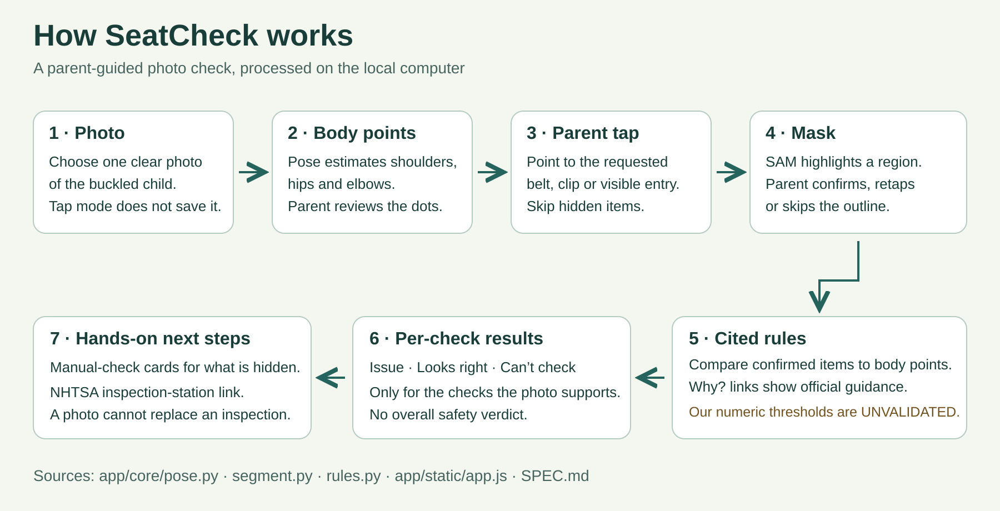

# SeatCheck

A parent guided photo check for car seat and booster fit.

Congressional App Challenge, AR-03

Yeshwanth Mathavan, Bentonville West High School

## Why I built this

In Arkansas, 89.5% of the car seats that were inspected had a problem, the worst rate in the country. Mistakes like a belt on the neck or a harness that sits wrong can be hard to spot by eye. I looked for a tool that checks belt fit from a photo and could not find one, so I built SeatCheck to give parents a quick first look and then point them to a certified technician.

## The problem

In 2025, problems were found in **89.5% of inspected Arkansas car seats**, compared with **73.7% nationally**, in the AAA and National Safety Council inspection data reported by [Insurify](https://insurify.com/car-insurance/news/worst-states-for-child-car-seat-safety/).
These inspections are voluntary, so these percentages do not estimate every family's car seat use. The [National Digital Car Seat Check Form dashboard](https://carseatcheckform.org/national-dashboard) explains the limits of inspection samples.

## What SeatCheck does

Choose a photo of a child buckled in, review the estimated body points, and tap the visible belt or harness item. Confirm the strap outline, then read what the photo measurement suggests and how to recheck it.

The quality gate can withhold a check for a dark or small photo, unclear body points, or missing evidence. Visible items are measured in a shoulder width unit, so the ruler scales with the child in the photo. Each result says issue, looks right, or check by hand, with a suggested next step and a source link. The app never says “safe.”

No account, no cloud photo processing, and no saved photos in normal tap mode. Safari sends the image to the local computer, which processes it in memory. The NHTSA button opens the [official inspection locator](https://www.nhtsa.gov/vehicle-safety/car-seats-and-booster-seats#installation-help-inspection); enter your ZIP there and confirm availability with the station.

## How it works



The iPhone interface uses plain JavaScript, HTML and CSS in Safari. Flask and Waitress run on the local computer. OpenCV handles image operations, RTMPose through ONNX Runtime estimates body points, and MobileSAM through PyTorch produces candidate outlines. The geometry in `app/core/rules.py` follows qualitative AAP and NHTSA guidance, with my own UNVALIDATED numeric thresholds. [Read the rule sources](docs/RULE_SOURCES.md).

The optional X-ray view overlays the raw skeleton, confirmed masks, reference lines and measurement arrows on the same photo. It only draws results already computed; it does not run another fit check.

### Design decisions

1. Geometry instead of a single image verdict: individual checks can explain their measurements and abstain separately.
2. A shoulder width unit instead of fixed pixels: the ruler scales and tilts with the estimated body.
3. Parent taps instead of pretending a generic segmentation model knows every belt: each outline needs confirmation.
4. All mask candidates instead of the highest model score alone: reject body sized candidates, then prefer the item's shape.
5. A quality gate instead of always producing an answer: missing evidence can produce cannot check.
6. Local processing instead of sending photos to a hosted vision service: the phone uses the computer on the same network.
7. Plain web screens instead of a native build: the same controls work in Safari and a Home Screen shortcut.
8. Cited guidance plus separate numeric guesses: official advice does not validate the photo thresholds.

`HIP_CORRECTION` and `NECK_CORRECTION` are enabled in normal startup; both are anatomy based, UNVALIDATED reference guesses. `BODY_BRIGHTNESS`, `MULTI_TAP`, `STRAP_ENTRY_CUE`, `EMPTY_SLOT_CUE` and `POSE_CACHE` default to OFF. The existing flag paths and their imported source helpers are retained to preserve behavior, not as claims of tested improvements.

## Run it

Use a Mac with Python 3.9 to 3.12 and Git. Python 3.9.6 was used for the fresh environment check. No Node or frontend build is needed to run the app.

From the cloned repository:

```sh
python3 -m venv .venv/app
source .venv/app/bin/activate
python -m pip install --upgrade pip
python -m pip install -r requirements.txt
./scripts/phone.sh
```

Keep the terminal open and the Mac awake. The script prints the exact `http://IP:8765` address; open it in Safari on an iPhone connected to the same private Wi-Fi. Use HTTP with the printed port. Guest networks and VPNs can prevent the phone from reaching the computer. The script uses `en0`; pass another interface if needed, such as `./scripts/phone.sh en1`.

Models load when the first photo is processed. RTMPose's detector and pose weights download through rtmlib, and MobileSAM downloads its pinned official checkpoint through `app/core/segment.py`. This first use needs internet and can take longer; later photo inference runs locally. Weights are not included in Git. MobileSAM comes from its [official repository](https://github.com/ChaoningZhang/MobileSAM), pinned in requirements.txt. Model and package licenses remain their authors' terms.

For a Mac only check, or when another instance already uses port 8765:

```sh
python -m app.server --host 127.0.0.1 --port 8766
```

Open `http://127.0.0.1:8766`. This loopback address is for the Mac; the phone needs the LAN address printed by the start script. Stop either server with Ctrl-C. Safari can also use Share, Add to Home Screen; the shortcut still needs the Mac running. There is no offline cache.

Run the included synthetic arithmetic tests from the repository root:

```sh
python -m unittest discover -s tests -v
```

The tests use generated points and masks, not private photos. No dataset or model weights are included.

## Honest limits

All numeric thresholds, image quality cutoffs and body reference proxies are **UNVALIDATED first guesses**. They need broader independent testing. A looks right result is about one visible measurement, not the whole installation.

An earlier frozen run was compared with one certified technician's grading of **23 staged photos**, from one car and one child. **15 of 31 decisive checks agreed**; the app abstained on **15 of 46 checks**. That is partial agreement on a small staged sample, not an accuracy claim for other children, seats or cars. Current reference corrections have not received a new independent grading run.

The app abstains when its evidence checks fail, but it cannot promise to catch every bad photo or mistaken landmark. A photo cannot establish harness tension, installation tightness, expiration, recalls or a hidden slot. Those checks remain manual. Thick clothing also needs a hands on check. Seat and vehicle instructions take precedence, and SeatCheck is not a substitute for a certified technician.

## Code comments

The comments in `rules.py` and `quality.py` were rewritten for readability after the expert graded test run. Their code is identical to the graded version when Python ASTs are compared with docstrings removed. For `rules.py`, the original SHA-256 is `afa451a5b4b3c26640def916815ace4d23095edc459abe0504e9fad65fe41c09` and the public SHA-256 is `7122447e7f390c08a7c9cbf1bd0a2fb5f4d8673a388d2ba36537dc3fc382c7eb`; for `quality.py`, the original SHA-256 is `81d9c000588bf829309c7d8274365ae8db81695c5c9b2d5c9cf8700e17092110` and the public SHA-256 is `1ff319d6b870b7ede2ceb16f4003890570a197e6da169358a45be2b7bc2142d7`.

## AI use

Read my [AI usage disclosure](AI_USAGE.md).

## Credits

Heather L. Smith, BS, CPST-I (Arkansas Children's Hospital), graded the 23 test photos; no endorsement implied.

All rights reserved. Shared for Congressional App Challenge judging.
